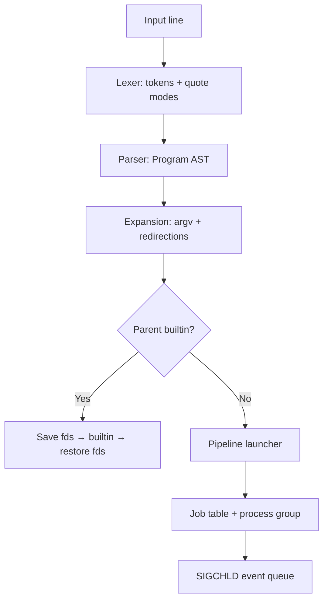
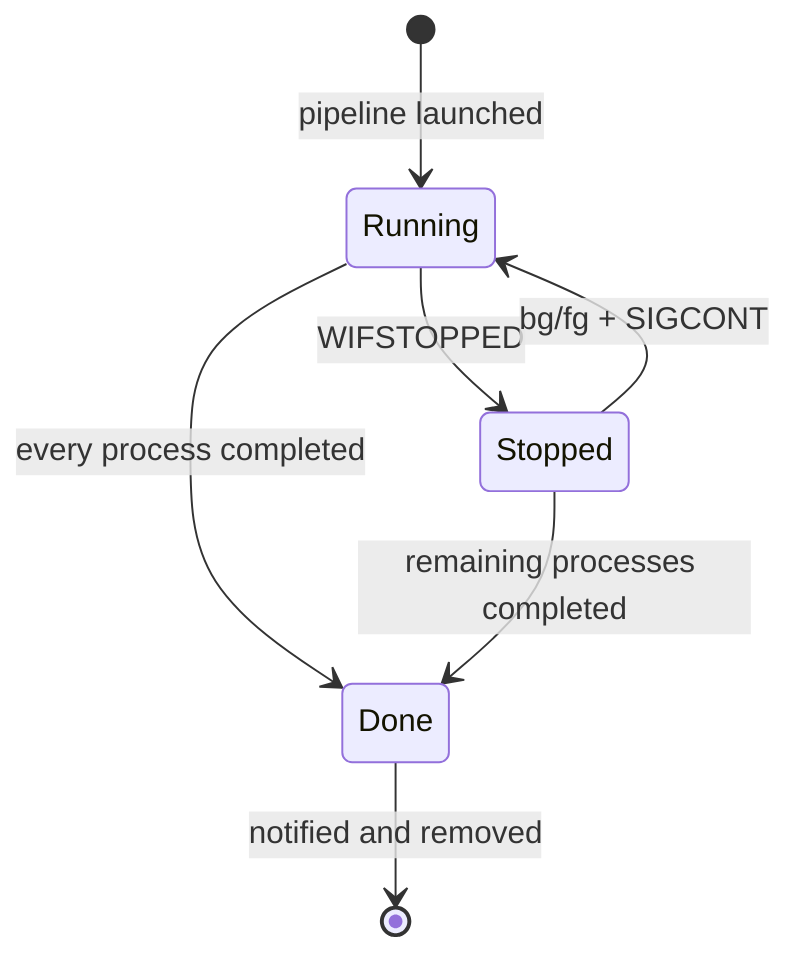

# Architecture

## Execution path



The lexer does not flatten a word into a plain string. Each word retains a sequence of unquoted, single-quoted, double-quoted, or backslash-literal parts. That representation lets expansion preserve the distinctions needed for variable substitution, field splitting, and glob suppression.

The parser produces three levels:

```text
Program  := AndOr ((';' | '&') AndOr)*
AndOr    := Pipeline (('&&' | '||') Pipeline)*
Pipeline := Command ('|' Command)*
Command  := (Word | Redirection)+
```

Redirections remain attached to their command in source order. Parsing transfers ownership of each `Word` from the token array into the AST; the token and AST destructors consequently never share an owning pointer.

## Expansion

Expansion happens immediately before a pipeline launches, not during parsing. This is necessary for a line such as `false; echo $?`: the second command must observe the first command's freshly updated status.

For each word, `expand.c` performs:

1. leading unquoted tilde expansion;
2. `$VAR`, `${VAR}`, `$?`, and `$$` substitution according to quote mode;
3. default-whitespace field splitting only at unquoted characters;
4. pathname expansion only for unquoted glob metacharacters;
5. literal fallback when a glob matches nothing.

A parallel quote-bit array accompanies the expanded character buffer. This avoids lossy heuristics such as trying to reconstruct which `*` characters were quoted after concatenating word parts.

## Pipeline construction and fd ownership

For an *N*-stage pipeline, the parent creates *N−1* pipes and one launch-barrier pipe. All descriptors receive `FD_CLOEXEC` immediately.

Each child performs this sequence:

1. enter the pipeline process group;
2. wait on the launch barrier;
3. restore default signals and the pre-launch signal mask;
4. connect the previous pipe to stdin and/or the next pipe to stdout;
5. close every original pipe descriptor;
6. apply command redirections in lexical order;
7. run a builtin or call `execvp()`.

The parent calls `setpgid(child, pgid)` as well as the child calling `setpgid(0, pgid)`. Either side can win without correctness depending on scheduling. Once all children exist, the foreground terminal is assigned to the process group and the barrier is released. The parent then closes every pipe descriptor it owns.

The invariant is simple: after launch, only a pipeline stage that actively writes a pipe owns that pipe's write end. Therefore the final reader sees EOF as soon as all writers exit.

## Job-control state machine



Every `Job` owns a process group id, display command, state, terminal modes, and a linked list of member processes. A process is complete, stopped, or active. The aggregate job is:

- `Done` when every process is complete;
- `Stopped` when every non-complete process is stopped;
- `Running` otherwise.

The pipeline's exit status is the status of its last process. Normal exits use the child's status; signal exits use `128 + signal`; stopped foreground jobs likewise expose `128 + stop_signal`.

## SIGCHLD without unsafe structure mutation

`SIGCHLD` may arrive before the parent finishes adding a child to its job. The shell blocks it before creating the `Job`, keeps it blocked across every `fork()` and `setpgid()`, and restores the previous mask only when all process records exist.

The handler repeatedly calls:

```c
waitpid(-1, &status, WNOHANG | WUNTRACED | WCONTINUED)
```

It writes only `(pid, status)` values into a fixed ring and one byte to a nonblocking self-pipe. It never allocates memory, prints, or follows linked lists. With `SIGCHLD` blocked, normal code drains the ring and updates the job table. The self-pipe also wakes the line editor's `poll()` so background completion can be reported while the user is sitting at an empty prompt.

Foreground waiting uses the standard block/check/`sigsuspend()` pattern, preventing the lost-wakeup race between observing `Running` and going to sleep.

## Terminal ownership and signals

The interactive shell puts itself in its own process group and ignores interactive terminal signals. Each external pipeline gets a new process group. `tcsetpgrp()` points the terminal at the foreground pipeline, so the kernel delivers Ctrl+C and Ctrl+Z to that group—not the shell.

After a job completes or stops, the shell:

1. saves the stopped job's terminal modes when relevant;
2. reclaims the terminal with `tcsetpgrp()`;
3. restores its own canonical terminal modes;
4. removes a completed job or retains a stopped one.

`fg` repeats the transfer and sends `SIGCONT`; `bg` sends `SIGCONT` without giving away the terminal.

## Builtins and parent state

A standalone builtin runs in the shell process. Before running one, the executor duplicates fds 0–2, applies requested redirections, flushes stdio, and restores all three descriptors. Consequently `cd >log` changes the real working directory without permanently redirecting later commands.

A builtin used in a pipeline or background job runs in a child. Its state changes intentionally disappear when that child exits, as in established shells.

## Line editor choice

The project implements its own editor with `termios` and `poll()` instead of GNU Readline. This keeps the binary dependency-free, demonstrates terminal-mode transitions, and lets the self-pipe participate directly in the input event loop. The editor supports history navigation, cursor movement, Home/End, Delete/Backspace, Ctrl+A/E/K/U/L, Ctrl+C cancellation, and Ctrl+D EOF.

## Resource verification

- `tests/stress.py` inspects the long-lived shell itself before and after 100 four-stage pipelines; its fd count remains 5.
- The same test launches another 100 background jobs and checks `/proc` for zombie children.
- `tests/memory_check.py` enables glibc's allocation tracer and rejects any allocation without a corresponding free/reallocation event.
- Sanitizer builds enable ASan and UBSan. The functional, PTY, and stress suites run under the instrumented binary.

